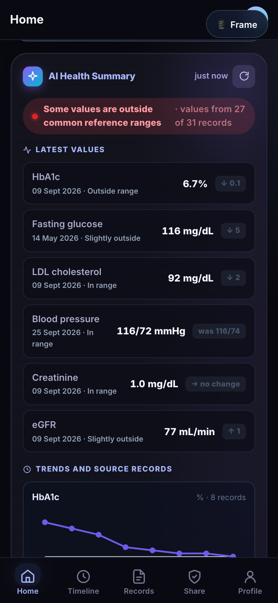
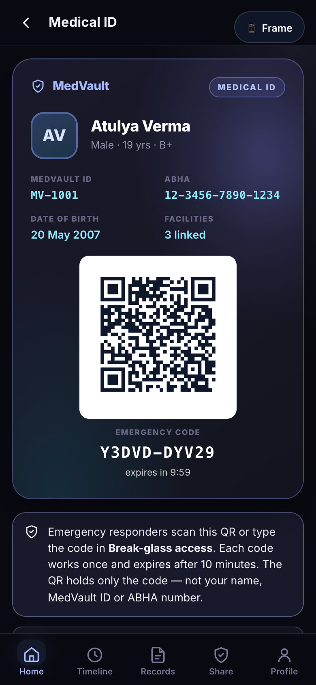
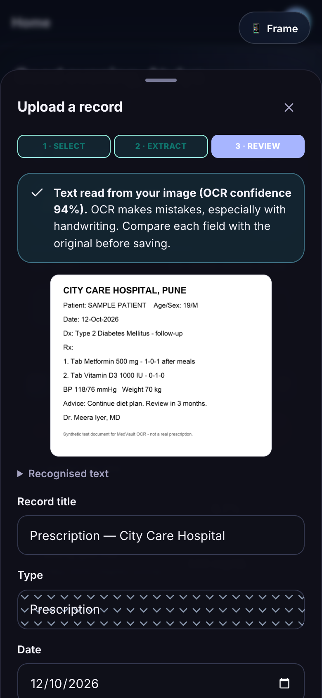

<div align="center">

# 🩺 MedVault

### One patient. One secure medical ID.

**An AI-assisted digital health record — mobile-first, patient-controlled, and built to keep a person's medical history organised, understandable and available when it matters most.**

[](#)
[](#-technology)
[](#)

[**🚀 Try the live demo →**](https://atxlya.github.io/MedVault/)

</div>

---

<p align="center">
  
  
  
</p>

---

## 📖 Contents

- [The Problem](#-the-problem)
- [What MedVault Does](#-what-medvault-does)
- [Features](#-features)
- [Roles](#-roles)
- [How It Works](#%EF%B8%8F-how-it-works)
- [Try It](#-try-it)
- [Technology](#-technology)
- [Project Structure](#-project-structure)
- [Running Locally](#-running-locally)
- [Deployment](#-deployment)
- [License](#-license)

---

## 🩹 The Problem

Medical information is scattered across hospitals, clinics, labs, pharmacies and paper folders. Patients repeat the same history at every visit, reports get lost, and lab results are hard to compare over time. In an emergency, the people treating a patient may not know their allergies or medicines.

## 💡 What MedVault Does

MedVault gives each person one secure home for their medical history:

| | |
|---|---|
| 🗂️ **Digital Medical Vault** | Prescriptions, lab reports, scans, discharge summaries, vaccinations and consultation notes in one timeline, with the original files kept alongside. |
| 📷 **Scan to digitise (OCR)** | Photograph a document and MedVault reads the text, fills in the fields, and lets you check them before saving. |
| 📊 **Health Summary** | Your latest lab values and vital signs from every record, with trends over time and links back to the source documents. |
| 💬 **Health Assistant** | Ask questions like "What was my last BP?" and get answers drawn from your own records, with sources. |
| 💊 **Medicines & Reminders** | Turn a scanned prescription into your medicine list, then set medicine, appointment and check-up reminders. |
| 🚨 **Emergency Access** | A one-time QR code on your Medical ID gives responders scoped, time-limited access to what matters in an emergency. |
| 🔐 **Consent & Audit** | You decide which providers see which records and for how long. Every access is logged. |

---

## ✨ Features

### 🗂️ Digital Medical Vault
- Chronological timeline of every record
- Search across titles, facilities, summaries and tags
- Filter and sort by record type
- Original uploaded files stored with each record — open or download any time

### 📷 OCR Document Scanning
- Reads printed prescriptions and reports from photos, right in the browser
- Fills in facility, doctor, date, diagnosis, medicines, lab results, vitals and advice
- Shows the image, recognised text and confidence side by side for review
- Nothing is saved until you confirm the details

### 📊 Health Summary & Trends
- Newest value for HbA1c, fasting glucose, LDL, blood pressure, creatinine and eGFR
- Trend charts with every point linked to its source record
- Grouped by body system, compared with common reference ranges
- Suggested questions to bring to your next doctor's visit

### 💬 Health Assistant
- Answers questions about your measurements, results, prescriptions and history
- Every answer cites the records it came from
- Respects access rules — it only sees what the current user is allowed to see

### 💊 Medicines, Appointments & Reminders
- Add medicines from a prescription to your list with one confirmation step
- Daily medicine reminders at times you choose
- Appointment and check-up reminders
- Optional device notifications

### 🚨 Emergency Access
- Medical ID with a scannable QR holding a one-time emergency code
- Codes work once and expire after 10 minutes — no name or ID in the QR
- Responders see blood group, allergies, conditions, medicines and emergency contact
- Sessions end automatically after 30 minutes and are reviewed by an administrator

### 🔐 Consent, Caregivers & Audit
- Grant, edit, revoke and expire consent per provider and record type
- Caregivers can manage records for children or elderly parents
- Full access log of every view, upload, share and emergency access

---

## 👥 Roles

| Role | What they can do |
|---|---|
| 🧑 **Patient** | Manage records, medicines, reminders, consents, caregivers and the emergency profile; view the health summary; use the assistant. |
| 👩‍👦 **Caregiver** | Do the same on behalf of one or more linked patients. |
| ⚕️ **Provider** | Look up patients, request consent, view consented records, upload records and link records in person. |
| 🛡️ **Admin** | Manage users and facilities, review emergency access events and inspect the audit trail. |
| 🚑 **Emergency responder** | Open a scoped, time-limited emergency view with the patient's one-time code. |

---

## ⚙️ How It Works

```
Upload / scan  →  OCR + review  →  Digital vault  →  Summary · Assistant · Medicines · Emergency
                                        │
                                  Consent decides who can see it · Every access is logged
```

1. A patient, caregiver or provider uploads or photographs a document.
2. MedVault reads the text and fills in the record; the uploader reviews it.
3. The record and its original file are saved to the patient's timeline.
4. The Health Summary, Assistant, medicine list and emergency profile use the new information.
5. Consent controls provider access, and every action is recorded in the audit log.

---

## 🔑 Try It

All demo accounts use the password **`demo123`**.

| Role | Email |
|:---|:---|
| 🧑 Patient | `patient@medvault.demo` |
| 👩‍👦 Caregiver | `caregiver@medvault.demo` |
| ⚕️ Provider | `doctor@medvault.demo` |
| 🛡️ Admin | `admin@medvault.demo` |

**Scan a prescription:** sign in as the patient → **Upload a record** → choose [`docs/samples/sample-prescription.png`](docs/samples/sample-prescription.png).

**Emergency access:** sign in as the patient → open **Medical ID** and note the emergency code → sign out → **Break-glass access** on the login screen → enter the code.

The demo data includes 3 patients, 4 providers across 5 facilities, and 33 medical records from November 2023 to September 2026.

---

## 🛠️ Technology

- **Plain HTML, CSS and JavaScript** — no framework, no build step
- **Browser storage** — `localStorage` for records, IndexedDB for original files
- **[Tesseract.js](https://github.com/naptha/tesseract.js)** for in-browser OCR, loaded on first use
- **[qrcode-generator](https://github.com/kazuhikoarase/qrcode-generator)** for QR codes (bundled, MIT)
- **Custom SVG charts** and an Inter-based design system with light and dark themes

---

## 📁 Project Structure

```
medvault/
├── index.html                 ← Page shell + script loader
├── css/styles.css             ← Design system and component styles
├── docs/
│   ├── screenshots/           ← App screenshots
│   └── samples/               ← Sample prescription image for trying OCR
└── js/
    ├── core.js                ← Utilities, formatting, QR, icons
    ├── data.js                ← Record types + demo database
    ├── store.js               ← Persistence, session, audit, notifications
    ├── ui.js                  ← Toasts, sheets, fullscreen views, sample documents
    ├── files.js               ← Original file storage (IndexedDB)
    ├── app.js                 ← App controller, navigation, roles
    ├── emergency-access.js    ← One-time emergency codes and sessions
    ├── ai.js                  ← Health Summary and trends
    ├── ocr.js                 ← OCR and the document review form
    ├── assistant.js           ← Health Assistant
    ├── reminders.js           ← Reminders and device notifications
    ├── screens-auth.js        ← Sign-in and emergency entry
    ├── screens-patient.js     ← Patient and caregiver screens
    ├── screens-provider.js    ← Provider portal
    ├── screens-admin.js       ← Admin dashboard
    ├── screens-emergency.js   ← Emergency responder view
    ├── main.js                ← Boot
    └── vendor/                ← Bundled QR code library
```

---

## 🚀 Running Locally

Serve the folder with any static server, then open **http://localhost:5173**:

```bash
python3 -m http.server 5173
```

Or with Node.js:

```bash
npx serve -l 5173
```

No installation and no build step. OCR needs an internet connection the first time it runs.

---

## 🌐 Deployment

MedVault is a static site and deploys anywhere that serves files — GitHub Pages, Netlify, Vercel or Cloudflare Pages — with no configuration.

**GitHub Pages:** Settings → Pages → Deploy from a branch → `main` / `(root)`.

---

## 📄 License

No license has been specified yet. The bundled QR code library in `js/vendor/` keeps its own MIT license.

---

<div align="center">

MedVault is a prototype for demonstration and does not provide medical advice.

**One patient. One secure medical ID.**

</div>
